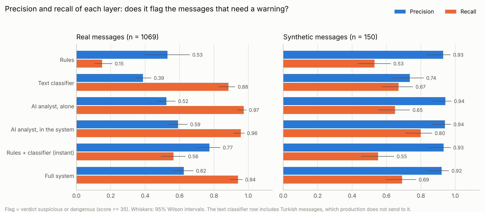
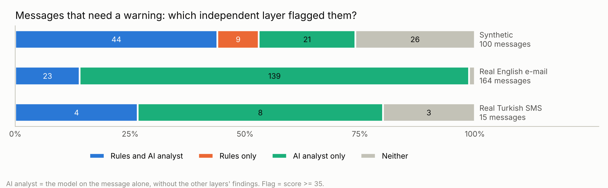
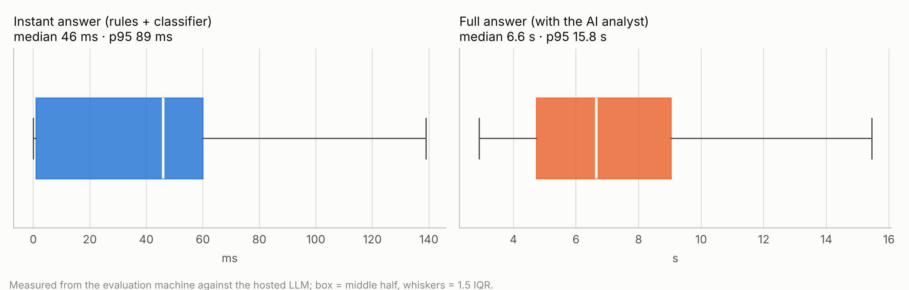
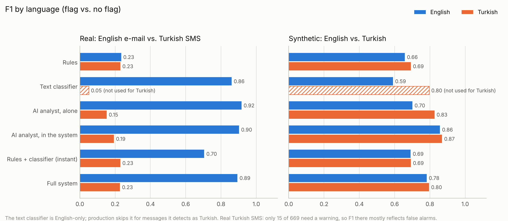
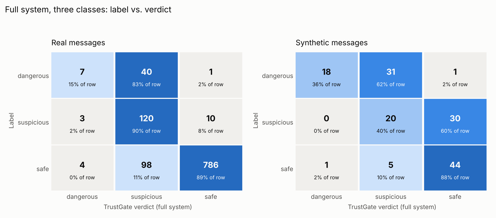

# Evaluation: does TrustGate warn about scams without crying wolf?

Measured on 12 October 2026 for the University of Derby Cyber AI Hackathon 2026.
- **System under test:** the deployed version (`main` at `126329d`), measured layer by layer.
- **Test sets:**
  - 1,069 real messages: 400 English e-mails and 669 Turkish SMS
  - 150 synthetic messages in English and Turkish, over SMS, WhatsApp and e-mail
- **Protocol:** the sets and their labels were committed before the run. The run was done once, and the numbers below are reported as they came out.

**In short:**
- **Scams almost always get a warning.** 47 of 48 real scams and 49 of 50 synthetic ones were flagged. But most of them are graded "suspicious" rather than "dangerous".
- **"Check this first" messages are the gap.** Real ones were mostly caught (123 of 133), but only 20 of the 50 subtler synthetic ones were.
- **About one real message in nine that needs no warning gets one.** 102 of 888, mostly commercial spam (75); 27 of them were ordinary personal or business messages.
- **Each layer has a job.**
  - The AI analyst finds most scams on real e-mail.
  - The rules catch crafted cases the AI misses, and keep the instant answer precise.
  - Seeing the rules' findings makes the AI analyst better.
- **Speed and cost:**
  - The instant answer takes about 50 ms.
  - The full answer takes about 7 s.
  - At public per-token prices, the LLM costs $0.25–0.65 per 1,000 checks.

| Part | Messages (dangerous / suspicious / safe) | Dangerous flagged | Suspicious flagged | False alarms on safe | Precision | Recall | F1 |
|---|---|---:|---:|---:|---:|---:|---:|
| Real, all | 1069 (48 / 133 / 888) | 47/48 | 123/133 | 102/888 | 0.62 | 0.94 | 0.75 |
| Real, English e-mail | 400 (44 / 122 / 234) | 43/44 | 116/122 | 31/234 | 0.84 | 0.96 | 0.89 |
| Real, Turkish SMS | 669 (4 / 11 / 654) | 4/4 | 7/11 | 71/654 | 0.13 | 0.73 | 0.23 |
| Synthetic, all | 150 (50 / 50 / 50) | 49/50 | 20/50 | 6/50 | 0.92 | 0.69 | 0.79 |
| Synthetic, English | 75 (25 / 25 / 25) | 25/25 | 9/25 | 3/25 | 0.92 | 0.68 | 0.78 |
| Synthetic, Turkish | 75 (25 / 25 / 25) | 24/25 | 11/25 | 3/25 | 0.92 | 0.70 | 0.80 |

Positive = the message needs a warning (dangerous or suspicious). "Flagged" = TrustGate said suspicious or dangerous. The real Turkish SMS are almost all safe, so their precision and F1 are low by construction. That row mainly measures false alarms.



## Findings

### 1. Almost every scam gets a warning. Subtle "check first" messages often do not.

| Label | Real | Synthetic |
|---|---:|---:|
| dangerous: flagged | 47/48 | 49/50 |
| suspicious: flagged | 123/133 | 20/50 |

- **What the 30 missed synthetic "check first" messages are:**
  - unsolicited job, loan or investment offers: 10
  - deposits or payments to a third party, often under time pressure: 10
  - bank-detail or phone-number changes from a known contact: 4
  - requests to move the chat to WhatsApp or Telegram: 4
  - other: 2
- **Most of them look harmless to both layers.** The rules stayed under 35 on all 30, and the analyst rated 20 of them at 30 or lower.
- **In the other 10,** the analyst said 35–60, and averaging with the rules pulled the result under 35.
- **Part of this is policy.** The rubric asks for a check before acting on any unsolicited offer. TrustGate was built to let ordinary marketing through, and these offers read like marketing.
- **Across all classes,** in 8 synthetic cases the AI analyst on its own would have flagged the message but the full system did not.

### 2. Scams are flagged, but usually graded "suspicious", not "dangerous".

| Dangerous messages | Graded dangerous | Graded suspicious | Graded safe |
|---|---:|---:|---:|
| Real (48) | 7 | 40 | 1 |
| Synthetic (50) | 18 | 31 | 1 |

- **Why:** the AI analyst, on its own, graded 42 of the 50 synthetic dangerous messages "dangerous". Averaging pulls this down when the rules see little, and the analyst's safety floor lifts a message only to 35 (suspicious).
- **What the user sees:** "suspicious" still says "check before you pay", so the user is warned. But it is a weaker message than "do not pay".

### 3. The layers cover each other.



"AI analyst" here is the model alone, without the other layers' findings, so the two detectors are independent.
- **Synthetic set (100 messages that need a warning):**
  - The rules caught 9 that the AI analyst alone missed. Seven of them are link or payee checks: a brand name hidden in a subdomain, or a payee name that does not match the sender.
  - The AI analyst caught 21 that the rules missed.
  - The full system flagged all 9 rules-only cases and 13 of the 21 AI-only ones.
- **Real English e-mail:** the AI analyst does almost all the catching. The rules caught only 23 of the 164 messages that need a warning, and all 23 were also flagged by the AI analyst.
  - The rules' value here is precision: rules + classifier together answer instantly with 0.88 precision and 6% false alarms.
- **Seeing the rules' findings makes the analyst better.** It can also anchor the analyst downwards. In one Turkish WhatsApp account-takeover message, the analyst scored 80 alone but 50 inside the system, so the full system missed it.

The analyst alone compared with the same model inside the system:

| Set | Measure | AI analyst alone | AI analyst in the system |
|---|---|---:|---:|
| Synthetic | recall | 0.65 | 0.80 |
| Synthetic | precision | 0.94 | 0.94 |
| Real | false alarms | 159/874 | 119/874 |
| Real | recall | 0.97 | 0.96 |

Three concrete cases follow in [Layers covering each other: examples](#layers-covering-each-other-examples).

### 4. Real false alarms are mostly marketing. One legitimate message in twenty gets a warning.

| False alarms | English e-mail | Turkish SMS |
|---|---:|---:|
| on commercial spam (the rubric calls it safe) | 21 of 35 | 54 of 337 |
| on legitimate messages | 10 of 199 (5.0%) | 17 of 317 (5.4%) |

- **Turkish SMS:** the AI analyst drives the false alarms. In 56 of the 71, it scored the message 70 or more.
  - A rule also fired in 25 of them, most often the gift-card rule (10) or the prize rule (4).
  - The fusion already halves the analyst's false alarms there: 20.5% when it is alone, 10.9% for the full system.
- **Legitimate English e-mail:** the AI analyst alone flagged only 2 of 199 legitimate e-mails, but the full system flagged 10. The other layers add these:
  - The classifier scored 8 of the 10 at 35 or more.
  - Link rules fired on most of them, such as "a link with a call to action" or "a link whose domain differs from the sender's".

### 5. Turkish is handled as well as English on the synthetic set, but language detection misses some real Turkish SMS.

- **Synthetic set:** the full system scores F1 0.80 in Turkish and 0.78 in English. It catches 24 of 25 Turkish scams and 25 of 25 English ones.
- **Language detection:**
  - It took 154 of the 669 real Turkish SMS (23%) for English. 141 of them contain no Turkish letters at all; 92 are commercial and 62 personal.
  - For those messages, the English-only text classifier scored Turkish text. It flagged 54 of the 145 safe ones.
  - Its weight is small (0.20), so the instant answer flagged none of them. The full system's false-alarm rate was 12.4% on them, against 10.4% on the Turkish SMS it recognised.
  - On the synthetic set, it missed 2 of the 75 Turkish messages.

### 6. Fast first answer, a few seconds for the full one, cheap per check.



| | Messages | Mean | Median | 95th percentile |
|---|---:|---:|---:|---:|
| Instant answer (rules + classifier) | 1219 | 35 ms | 46 ms | 89 ms |
| Full answer (with the AI analyst) | 1203 | 7.7 s | 6.6 s | 15.8 s |
| of which the LLM call | 1203 | 7.6 s | 6.6 s | 15.8 s |

- **Instant answer:** the median is 1 ms on Turkish SMS, where the classifier is skipped, and 64 ms on English e-mail (95th percentile 110 ms). That is where the two clusters in the chart come from.
- **Full answer:** the LLM call takes almost all of the time.
- **Production cost:** the deployed app pays a flat Featherless subscription instead of per token ([plans](https://featherless.ai/docs/plans), [concurrency](https://featherless.ai/docs/concurrency-limits)).
  - The Basic plan is $10 a month for models up to 15B parameters, with 2 concurrent requests.
  - At about 7.6 s per call, that is roughly 950 full checks an hour.
- **Price lists** (list prices for Qwen2.5-14B-Instruct, checked 12 October 2026):
  - [Fireworks AI](https://fireworks.ai/pricing): 4B–16B models
  - Alibaba Cloud Model Studio, as listed by [anotherwrapper.com](https://anotherwrapper.com/llm-pricing/qwen-2.5-14b-instruct)
- **The whole evaluation** used about 2.5 million prompt tokens and 0.5 million completion tokens, counting both the in-system and the stand-alone analyst calls.

### 7. The AI analyst's answer is unusable about 4% of the time on the first try.

- **First attempts:** 53 of 1,219 first answers (4.3%) could not be used.
- **The harness retry:**
  - The evaluation harness retried a check once when the analyst was unavailable, and 37 of those retries succeeded.
  - The deployed app retries only connection and server errors (the API client's own single retry), not malformed answers.
  - So in production, about 4% of full checks fall back to rules + classifier.
- **Fallbacks that remained:** 16 of 1,219 (1.3%). 12 of them were real Turkish SMS.
  - 8 answers were cut off at the 700-token output limit.
  - 7 failed the integrity code that guards against prompt injection.
  - 1 answer was empty.
- **Effect on the results:** small. As a worst case, every message that may have been retried was replaced by its rules + classifier verdict. Even then:

| Measure | As measured | Worst case |
|---|---:|---:|
| Real, recall | 0.94 | 0.93 |
| Real, false alarms | 102 | 96 |
| Synthetic, recall | 0.69 | 0.68 |

## Weak points to work on before the final

1. **Subtle "check first" messages are missed** (synthetic: 20 of 50 flagged; SMS: 3 of 17). Most of them look harmless to both the rules and the analyst.
   - **Idea:** give the rules and the analyst explicit "verify first" signals:
     - a request to move to WhatsApp or Telegram
     - a change of bank details
     - a deposit to a third party
     - an unsolicited investment, loan or job offer
   - **Idea:** when money or codes are involved, let a moderately confident analyst (35–65) count for more. Today only a score of 70 or more sets a floor.
2. **Scams are under-graded** (real: 7 of 48 graded "dangerous"; synthetic: 18 of 50).
   - **Idea:** let a confident analyst (80 or more), backed by at least one rule finding, raise the floor to "dangerous".
   - Keep the existing guard: when a message contains instructions aimed at AI systems, the analyst's score only counts if it raises the risk.
3. **False alarms on Turkish marketing SMS** (54 of 337 commercial SMS; 71 of 654 safe Turkish SMS overall).
   - **Idea:** teach the prompt and rules what legitimate bulk marketing looks like, such as opt-out instructions and no payment or credential request.
   - **Idea:** narrow the gift-card rule, which fired on 10 of these commercial false alarms.
4. **Warnings about scams look like scams.**
   - A bank's fraud-awareness newsletter was graded "dangerous" by a rule floor of 80, although the AI analyst scored it 0–10.
   - A relative's warning about a scam was graded "suspicious".
   - **Idea:** make the rules aware of negation and quotes ("we will never ask you to…").
5. **Verified bank-detail changes are still flagged** (all 3 safe cases where the message says the change was already verified).
   - This may be acceptable policy ("always verify"). It should be a deliberate choice.
6. **Rules miss requests with no keyword or link.** Example: "reply with the 6-digit code to cancel" scored 0 on the rules.
   - **Idea:** add rules for forwarding or replying with one-time codes, in both languages.
7. **Language detection misses 23% of real Turkish SMS.**
   - **Idea:** replace the word-list heuristic with a character n-gram language identifier, or add a Turkish classifier.
8. **The analyst's unusable answers** (4.3% on the first try).
   - **Idea:** a shorter output schema or a higher token limit, plus one retry on a malformed answer, which the harness showed rescues most of them.
9. **The evaluation's own gaps:** no human-checked labels yet, no real WhatsApp data, and an old Turkish set. See [Limitations](#limitations-of-this-evaluation).

**How to fix these without fooling ourselves:**
- Every change above must be developed and tuned on other data: the earlier dev scenarios, or a fresh synthetic batch from a new writer.
- This test set stays frozen. It will be re-run once, unchanged, before the final, and both runs will be reported side by side.

## Layers covering each other: examples

The cases below are from the synthetic set. All names and domains are invented, so they can be quoted. Real messages are never quoted.

**The AI analyst covers the rules: E033 (SMS, dangerous).**
> Harbourline Bank: A payment of £640.00 to ZENVOLT ELECTRONICS is pending on your account. If you did not make this payment, reply with the 6-digit code we have just sent you to cancel it.

| Layer | Score | What it saw |
|---|---:|---|
| Rules | 0 | no rule fired: no link, and no wording the rules know |
| Instant answer | 29 | safe |
| AI analyst | 70 (75 alone) | a bank impersonation that asks for a one-time code |
| **Full system** | **43** | **suspicious** |

**The rules cover the AI analyst: E017 (SMS, dangerous).**
> Postvale: We were unable to deliver your item today as a signature was required. You can choose a new delivery date or a collection point here: https://postvale.redelivery-options.com/r/7QK2M Thank you for choosing Postvale.

| Layer | Score | What it saw |
|---|---:|---|
| AI analyst, alone | 20 | taken in by the polite wording |
| Rules (static link analysis, without visiting the link) | 35 | the courier's name sits in the subdomain of an unrelated domain |
| AI analyst, in the system | 60 | given that finding, it raised its score |
| **Full system** | **50** | **suspicious** |

**The classifier tips the balance: E074 (WhatsApp, suspicious).**
> Hello! Thank you for supporting Harbour Hope Trust last winter 💙 Our winter coat appeal is now open – £25 keeps a child warm all season. You can donate here: https://give-now-appeals.org/harbourhope-winter Reply STOP to unsubscribe.

| Layer | Score | What it saw |
|---|---:|---|
| Rules | 24.6 | the donation link's domain does not match the charity, but that alone stays under the threshold |
| AI analyst, alone | 30 | |
| Text classifier | 97.6 | |
| Instant answer | 47 | suspicious, before the analyst has answered |
| AI analyst, in the system | 60 | given the link findings, it raised its score |
| **Full system** | **52** | **suspicious** |

**Where covering fails: E057 (e-mail, safe).** A bank newsletter lists three things the bank "will never" do: ask you to move money to a "safe account", ask for codes, or ask you to install software.

| Layer | Score | What it saw |
|---|---:|---|
| AI analyst | 0 alone, 10 in the system | correctly sees a warning, not a scam |
| Rules | floor of 80 | fired on "safe account" and "remote access" |
| **Full system** | **80** | **dangerous**: the rule floor overrides the analyst |

This is weak point 4.

## Detailed results

### Each layer on its own and together

**Real messages (1,069)**

| Layer | Precision (95% CI) | Recall (95% CI) | F1 | False alarms on safe | 3-class macro F1 | Answered |
|---|---:|---:|---:|---:|---:|---:|
| Rules | 0.53 (0.40–0.66) | 0.15 (0.10–0.21) | 0.23 | 24/888 (2.7%) | 0.38 | 1069/1069 |
| Text classifier ¹ | 0.39 (0.34–0.43) | 0.88 (0.83–0.92) | 0.54 | 253/888 (28.5%) | 0.41 | 1069/1069 |
| AI analyst, alone | 0.52 (0.47–0.58) | 0.97 (0.94–0.99) | 0.68 | 159/874 (18.2%) | 0.45 | 1053/1069 |
| AI analyst, in the system | 0.59 (0.53–0.65) | 0.96 (0.92–0.98) | 0.73 | 119/874 (13.6%) | 0.47 | 1054/1069 |
| Rules + classifier (instant) | 0.77 (0.69–0.84) | 0.56 (0.49–0.63) | 0.65 | 30/888 (3.4%) | 0.54 | 1069/1069 |
| **Full system** | 0.62 (0.57–0.68) | 0.94 (0.89–0.97) | 0.75 | 102/888 (11.5%) | 0.59 | 1069/1069 |

**Synthetic messages (150)**

| Layer | Precision (95% CI) | Recall (95% CI) | F1 | False alarms on safe | 3-class macro F1 | Answered |
|---|---:|---:|---:|---:|---:|---:|
| Rules | 0.93 (0.83–0.97) | 0.53 (0.43–0.62) | 0.68 | 4/50 (8.0%) | 0.45 | 150/150 |
| Text classifier ¹ | 0.74 (0.64–0.82) | 0.67 (0.57–0.75) | 0.70 | 24/50 (48.0%) | 0.41 | 150/150 |
| AI analyst, alone | 0.94 (0.86–0.98) | 0.65 (0.55–0.74) | 0.77 | 4/49 (8.2%) | 0.59 | 149/150 |
| AI analyst, in the system | 0.94 (0.87–0.97) | 0.80 (0.71–0.86) | 0.86 | 5/50 (10.0%) | 0.71 | 149/150 |
| Rules + classifier (instant) | 0.93 (0.84–0.97) | 0.55 (0.45–0.64) | 0.69 | 4/50 (8.0%) | 0.47 | 150/150 |
| **Full system** | 0.92 (0.84–0.96) | 0.69 (0.59–0.77) | 0.79 | 6/50 (12.0%) | 0.53 | 150/150 |

¹ The text classifier is English-only. Production skips it for messages it detects as Turkish. These rows apply it to every message anyway, for reference, which is why its false-alarm rate looks so high.

### By language



F1 for each layer (precision / recall in brackets):

| Layer | Real EN e-mail | Real TR SMS | Synthetic EN | Synthetic TR |
|---|---:|---:|---:|---:|
| Rules | 0.23 (0.74 / 0.14) | 0.23 (0.20 / 0.27) | 0.66 (0.90 / 0.52) | 0.69 (0.96 / 0.54) |
| Text classifier ¹ | 0.86 (0.80 / 0.93) | 0.05 (0.03 / 0.40) | 0.59 (0.68 / 0.52) | 0.80 (0.77 / 0.82) |
| AI analyst, alone | 0.92 (0.85 / 0.99) | 0.15 (0.08 / 0.80) | 0.70 (1.00 / 0.54) | 0.83 (0.91 / 0.76) |
| AI analyst, in the system | 0.90 (0.84 / 0.98) | 0.19 (0.11 / 0.73) | 0.86 (0.95 / 0.78) | 0.87 (0.93 / 0.82) |
| Rules + classifier (instant) | 0.70 (0.88 / 0.59) | 0.23 (0.20 / 0.27) | 0.69 (0.90 / 0.56) | 0.69 (0.96 / 0.54) |
| **Full system** | 0.89 (0.84 / 0.96) | 0.23 (0.13 / 0.73) | 0.78 (0.92 / 0.68) | 0.80 (0.92 / 0.70) |

Per-language tables with intervals and false alarms:

<details><summary>Real English e-mail (400)</summary>

| Layer | Precision (95% CI) | Recall (95% CI) | F1 | False alarms on safe | 3-class macro F1 | Answered |
|---|---:|---:|---:|---:|---:|---:|
| Rules | 0.74 (0.57–0.86) | 0.14 (0.09–0.20) | 0.23 | 8/234 (3.4%) | 0.34 | 400/400 |
| Text classifier | 0.80 (0.74–0.85) | 0.93 (0.88–0.96) | 0.86 | 38/234 (16.2%) | 0.48 | 400/400 |
| AI analyst, alone | 0.85 (0.80–0.90) | 0.99 (0.96–1.00) | 0.92 | 28/234 (12.0%) | 0.52 | 398/400 |
| AI analyst, in the system | 0.84 (0.78–0.88) | 0.98 (0.94–0.99) | 0.90 | 31/232 (13.4%) | 0.50 | 397/400 |
| Rules + classifier (instant) | 0.88 (0.80–0.92) | 0.59 (0.51–0.66) | 0.70 | 14/234 (6.0%) | 0.53 | 400/400 |
| **Full system** | 0.84 (0.78–0.88) | 0.96 (0.92–0.98) | 0.89 | 31/234 (13.2%) | 0.64 | 400/400 |

</details>

<details><summary>Real Turkish SMS (669)</summary>

| Layer | Precision (95% CI) | Recall (95% CI) | F1 | False alarms on safe | 3-class macro F1 | Answered |
|---|---:|---:|---:|---:|---:|---:|
| Rules | 0.20 (0.08–0.42) | 0.27 (0.11–0.52) | 0.23 | 16/654 (2.4%) | 0.33 | 669/669 |
| Text classifier ¹ | 0.03 (0.01–0.06) | 0.40 (0.20–0.64) | 0.05 | 215/654 (32.9%) | 0.28 | 669/669 |
| AI analyst, alone | 0.08 (0.05–0.14) | 0.80 (0.55–0.93) | 0.15 | 131/640 (20.5%) | 0.33 | 655/669 |
| AI analyst, in the system | 0.11 (0.06–0.19) | 0.73 (0.48–0.89) | 0.19 | 88/642 (13.7%) | 0.34 | 657/669 |
| Rules + classifier (instant) | 0.20 (0.08–0.42) | 0.27 (0.11–0.52) | 0.23 | 16/654 (2.4%) | 0.33 | 669/669 |
| **Full system** | 0.13 (0.08–0.22) | 0.73 (0.48–0.89) | 0.23 | 71/654 (10.9%) | 0.36 | 669/669 |

</details>

<details><summary>Synthetic English (75)</summary>

| Layer | Precision (95% CI) | Recall (95% CI) | F1 | False alarms on safe | 3-class macro F1 | Answered |
|---|---:|---:|---:|---:|---:|---:|
| Rules | 0.90 (0.74–0.96) | 0.52 (0.39–0.65) | 0.66 | 3/25 (12.0%) | 0.39 | 75/75 |
| Text classifier | 0.68 (0.53–0.81) | 0.52 (0.39–0.65) | 0.59 | 12/25 (48.0%) | 0.36 | 75/75 |
| AI analyst, alone | 1.00 (0.88–1.00) | 0.54 (0.40–0.67) | 0.70 | 0/24 (0.0%) | 0.59 | 74/75 |
| AI analyst, in the system | 0.95 (0.84–0.99) | 0.78 (0.65–0.87) | 0.86 | 2/25 (8.0%) | 0.71 | 75/75 |
| Rules + classifier (instant) | 0.90 (0.75–0.97) | 0.56 (0.42–0.69) | 0.69 | 3/25 (12.0%) | 0.43 | 75/75 |
| **Full system** | 0.92 (0.79–0.97) | 0.68 (0.54–0.79) | 0.78 | 3/25 (12.0%) | 0.48 | 75/75 |

</details>

<details><summary>Synthetic Turkish (75)</summary>

| Layer | Precision (95% CI) | Recall (95% CI) | F1 | False alarms on safe | 3-class macro F1 | Answered |
|---|---:|---:|---:|---:|---:|---:|
| Rules | 0.96 (0.82–0.99) | 0.54 (0.40–0.67) | 0.69 | 1/25 (4.0%) | 0.51 | 75/75 |
| Text classifier ¹ | 0.77 (0.65–0.86) | 0.82 (0.69–0.90) | 0.80 | 12/25 (48.0%) | 0.45 | 75/75 |
| AI analyst, alone | 0.91 (0.78–0.96) | 0.76 (0.63–0.86) | 0.83 | 4/25 (16.0%) | 0.60 | 75/75 |
| AI analyst, in the system | 0.93 (0.81–0.98) | 0.82 (0.69–0.90) | 0.87 | 3/25 (12.0%) | 0.71 | 74/75 |
| Rules + classifier (instant) | 0.96 (0.82–0.99) | 0.54 (0.40–0.67) | 0.69 | 1/25 (4.0%) | 0.51 | 75/75 |
| **Full system** | 0.92 (0.79–0.97) | 0.70 (0.56–0.81) | 0.80 | 3/25 (12.0%) | 0.58 | 75/75 |

</details>

### Synthetic set by channel, scenario and difficulty

Full system:

| Part | Messages (dangerous / suspicious / safe) | Dangerous flagged | Suspicious flagged | False alarms on safe | Precision | Recall | F1 |
|---|---|---:|---:|---:|---:|---:|---:|
| SMS | 50 (16 / 17 / 17) | 16/16 | 3/17 | 1/17 | 0.95 | 0.58 | 0.72 |
| WhatsApp | 50 (17 / 17 / 16) | 16/17 | 10/17 | 2/16 | 0.93 | 0.77 | 0.84 |
| E-mail | 50 (17 / 16 / 17) | 17/17 | 7/16 | 3/17 | 0.89 | 0.73 | 0.80 |
| Payment details given | 81 (37 / 28 / 16) | 37/37 | 13/28 | 3/16 | 0.94 | 0.77 | 0.85 |
| Changed bank details (IBAN) | 16 (5 / 8 / 3) | 5/5 | 5/8 | 3/3 | 0.77 | 0.77 | 0.77 |
| Contains a link | 54 (19 / 20 / 15) | 19/19 | 6/20 | 1/15 | 0.96 | 0.64 | 0.77 |
| AI agent asks before paying | 17 (6 / 5 / 6) | 6/6 | 4/5 | 0/6 | 1.00 | 0.91 | 0.95 |
| Turkish typed without Turkish letters | 21 (7 / 7 / 7) | 6/7 | 2/7 | 1/7 | 0.89 | 0.57 | 0.69 |
| Difficulty: easy | 41 (18 / 8 / 15) | 18/18 | 0/8 | 0/15 | 1.00 | 0.69 | 0.82 |
| Difficulty: medium | 71 (21 / 29 / 21) | 21/21 | 11/29 | 0/21 | 1.00 | 0.64 | 0.78 |
| Difficulty: hard | 38 (11 / 13 / 14) | 10/11 | 9/13 | 6/14 | 0.76 | 0.79 | 0.78 |

- **Payment cases:** every dangerous case with payment details was flagged (37 of 37).
- **Agent mode:** AI agents asking before paying form a small group (17), but the system flagged 10 of 11 there and raised no false alarm.
- **Changed bank details:** all 3 false alarms come from changes that the message says were already verified.
- **Difficulty:** "easy" and "medium" cases produced no false alarm at all. Every synthetic false alarm comes from the "hard" cases.

### Three classes



<details><summary>Confusion matrices by language (full system)</summary>

Real English e-mail:

| Label ↓ / verdict → | dangerous | suspicious | safe |
|---|---:|---:|---:|
| dangerous | 7 | 36 | 1 |
| suspicious | 2 | 114 | 6 |
| safe | 1 | 30 | 203 |

Real Turkish SMS:

| Label ↓ / verdict → | dangerous | suspicious | safe |
|---|---:|---:|---:|
| dangerous | 0 | 4 | 0 |
| suspicious | 1 | 6 | 4 |
| safe | 3 | 68 | 583 |

Synthetic English:

| Label ↓ / verdict → | dangerous | suspicious | safe |
|---|---:|---:|---:|
| dangerous | 7 | 18 | 0 |
| suspicious | 0 | 9 | 16 |
| safe | 1 | 2 | 22 |

Synthetic Turkish:

| Label ↓ / verdict → | dangerous | suspicious | safe |
|---|---:|---:|---:|
| dangerous | 11 | 13 | 1 |
| suspicious | 0 | 11 | 14 |
| safe | 0 | 3 | 22 |

</details>

[`derby/results/tables.md`](derby/results/tables.md) has the confusion matrix of every layer on every subset.

### Which independent layer flagged what

Synthetic:

| Independent layers that flagged it | Messages | Full system flagged |
|---|---:|---:|
| Rules and AI analyst | 44 | 44 |
| Rules only | 9 | 9 |
| AI analyst only | 21 | 13 |
| Neither | 26 | 3 |

Real English e-mail (2 of the 166 messages that need a warning had no stand-alone analyst answer):

| Independent layers that flagged it | Messages | Full system flagged |
|---|---:|---:|
| Rules and AI analyst | 23 | 23 |
| Rules only | 0 | 0 |
| AI analyst only | 139 | 133 |
| Neither | 2 | 1 |

Real Turkish SMS:

| Independent layers that flagged it | Messages | Full system flagged |
|---|---:|---:|
| Rules and AI analyst | 4 | 4 |
| Rules only | 0 | 0 |
| AI analyst only | 8 | 7 |
| Neither | 3 | 0 |

### Real data by the source dataset's own labels

The source datasets label messages spam or legitimate. That is a different question from ours, because most spam is harmless marketing. The table shows the share of each group that each layer flagged.

| Source and its label | Messages | Rules | Classifier ¹ | AI analyst, alone | Rules + classifier | Full system |
|---|---:|---:|---:|---:|---:|---:|
| TREC 2007 e-mail, spam | 200 | 11.5% | 82.0% | 94.4% | 49.0% | 89.5% |
| TREC 2007 e-mail, legitimate | 200 | 4.0% | 14.0% | 1.5% | 7.0% | 5.5% |
| Turkish SMS, spam | 352 | 4.8% | 53.7% | 34.1% | 4.8% | 18.5% |
| Turkish SMS, legitimate | 317 | 0.9% | 10.1% | 8.3% | 0.9% | 5.4% |


## How this was measured

**System under test:** the deployed version, `main` at `126329d` (the code running on Render), used unchanged. Evaluation code lives in `eval/derby/` only. Three evaluation-only settings differ from production:
- The LLM call budget is raised. The production cap of 30 calls a minute would have turned part of the run into rule-only fallbacks.
- Every message is cut to the 6,000 characters the public API accepts.
- When the AI analyst was unavailable, the harness ran the check once more. Production does not do this; [finding 7](#7-the-ai-analysts-answer-is-unusable-about-4-of-the-time-on-the-first-try) shows how little it changes the results.

**Protocol:** the labelling rubric was written first. Then:
1. The test sets were built and labelled, and committed before any system output existed (commits `b91531d` and `214a920`).
2. Each set was run once, on 12 October 2026.
3. Nothing was tuned afterwards, and nothing was dropped after seeing results.

### Data

| Part | Source | Messages | How labelled |
|---|---|---:|---|
| Real, Turkish SMS | `akuysal/turkishSMS-ds` on Hugging Face (Uysal et al., 2013). No licence is stated, so it is used for measurement only: texts are never committed or quoted. | 669 of 850 | independent labelling agents, rubric below |
| Real, English e-mail | TREC 2007 public spam corpus, via `kudzaiprichard/aura-phishing-email-corpus` on Hugging Face (CC BY 4.0). 200 spam and 200 legitimate e-mails sampled with a fixed seed. | 400 | independent labelling agents |
| Synthetic, English | written for this evaluation by a separate AI agent with no access to the code or the rules | 75 | by the writer, same rubric |
| Synthetic, Turkish | written by another separate AI agent with no access to the code or the rules | 75 | by the writer, same rubric |

- Both synthetic sets are balanced: 25 dangerous, 25 suspicious and 25 safe each, and 25 each of SMS, WhatsApp and e-mail.
- They include payment details (81 cases), changed bank details (16), links (54), AI agents that ask before paying (17) and Turkish typed without Turkish letters (21).
- All people, companies, banks and domains in them are invented. A script checked them against TrustGate's list of real brands: [`derby/validate_synthetic.py`](derby/validate_synthetic.py).
- Real and synthetic results are always reported separately.
- [`derby/download_eval_data.py`](derby/download_eval_data.py) fetches the real data, pinned to exact revisions and checksums, into `data/eval/`. That folder is gitignored; the download is about 100 MB.

### Leakage control

The text classifier was trained on the UCI SMS Spam Collection and `zefang-liu/phishing-email-dataset`.
- **Source level:** neither real test source is, or derives from, those datasets.
- **Text level:** every test message was compared with all 23,672 raw training texts, using the classifier's own normalisation and two checks:
  - exact match
  - character 5-gram Jaccard similarity of 0.8 or more
- **Earlier scenarios:** the same check ran against our 164 earlier evaluation scenarios.
- **Result:** no message had to be dropped. The highest similarity of any kept real message to any training text is 0.55, and the median is 0.04. For the synthetic messages the highest is 0.13.
- **Internal duplicates** were removed: 82 Turkish SMS and 3 e-mails.
- **Short messages:** 99 Turkish SMS under 20 characters were skipped. All of them are one-line legitimate replies such as "ok". Skipping them makes the false-alarm measurement stricter, not easier.
- Per-message details: [`derby/real_set_index.json`](derby/real_set_index.json) lists ids, source labels, text hashes and the highest training similarity. It contains no text. Built by [`derby/build_real_set.py`](derby/build_real_set.py).

### Labels

Labels follow [`derby/RUBRIC.md`](derby/RUBRIC.md):
- **dangerous:** a scam, phishing or fraud attempt.
- **suspicious:** verify through a trusted channel before acting.
- **safe:** no meaningful risk. Ordinary commercial spam counts as safe: TrustGate judges scam risk, not spam.

**Real messages** were labelled by six independent AI labelling agents. They saw only the rubric and the messages: no source labels, no system output, no repository.
- A blind 10% sample (107 messages) was labelled again by the AI assistant that ran this evaluation, before it saw the agents' labels.
  - The two agreed on **97.2%** of labels.
  - Cohen's κ was 0.93 for three classes and 0.95 for flag vs. safe.
- The three disagreements are borderline cases, listed in [`derby/label_agreement.json`](derby/label_agreement.json).
- **No human has re-labelled these messages yet.** See the limitations.

Labels: [`derby/labels_real.jsonl`](derby/labels_real.jsonl) (ids and labels only) and [`derby/synthetic_set.jsonl`](derby/synthetic_set.jsonl) (full synthetic cases, each with the writer's one-line rationale).

### Layers and metrics

| Layer | What it is |
|---|---|
| Rules | the rule engine and static link analysis alone: `max(rule score, floor)` |
| Text classifier | TF-IDF + logistic regression alone: 100 × P(spam). English-only; production skips it for messages it detects as Turkish. |
| AI analyst, alone | the same model (Qwen2.5-14B-Instruct on Featherless) and system prompt, given only the message, with no signals from the other layers |
| AI analyst, in the system | the analyst's own score inside the deployed pipeline, where it sees the rule and classifier findings |
| Rules + classifier (instant) | the product's instant first answer |
| Full system | the deployed verdict: weighted fusion (rules 0.45, classifier 0.20, AI analyst 0.35) with safety floors |

- Every layer is mapped to a verdict with the product's thresholds: ≥ 35 suspicious, ≥ 70 dangerous.
- **Binary metrics** treat a message as positive when it needs a warning (dangerous or suspicious), and count a layer as flagging it when its verdict is suspicious or dangerous.
- **Three-class metrics** use the full 3 × 3 confusion matrix.
- **Intervals** are 95% Wilson intervals.
- When the AI analyst's answer fails (malformed or cut-off JSON, or a failed integrity check), the product falls back to rules + classifier. The full-system rows include those fallbacks, because that is what a user sees. The AI-analyst rows leave them out; the "Answered" column shows how many remain.

## Limitations of this evaluation

- **The real Turkish set is old and almost all safe.** It dates from around 2011. Only 15 of its 669 messages need a warning, so it mostly measures false alarms. Recall on it rests on 15 messages, and its interval is wide.
- **No real WhatsApp messages.** We found no real, licence-clear WhatsApp scam data on Hugging Face or UCI. WhatsApp is covered only by the synthetic set.
- **The synthetic messages were written by AI agents** and labelled by their writers. They may be cleaner and more typical than real scams. Their labels were not checked independently.
- **No human has checked the labels yet.** The real labels come from AI agents, with a second AI pass on a 10% sample. A human spot check of about 50 messages is planned before the final.
- **One run.** The AI analyst runs at temperature 0.1, so a re-run would move a few verdicts. We did not repeat the run.
- **Latency was measured from the evaluation machine,** with up to six requests in parallel, not from the Render deployment. The free Render plan also sleeps when idle: the first request after a sleep can take up to about a minute longer. An uptime monitor keeps it awake.
- **Costs are list-price estimates.** The deployed app uses a flat Featherless subscription, so the per-token prices in this report are only for comparison.

## Reproduce

```bash
python eval/derby/download_eval_data.py   # ~100 MB into data/eval/ (gitignored), pinned revisions + checksums
python eval/derby/build_real_set.py       # sampling and leakage filter -> data/eval/real_set.jsonl
python eval/derby/run_derby_eval.py --sets real --out eval/derby/results/raw_results_real.jsonl
python eval/derby/run_derby_eval.py --sets synthetic --workers 2 --out eval/derby/results/raw_results_synthetic.jsonl
cat eval/derby/results/raw_results_real.jsonl eval/derby/results/raw_results_synthetic.jsonl > eval/derby/results/raw_results.jsonl
python eval/derby/analyze.py              # metrics.json, tables.md and the charts
```

- The two runs need `LLM_API_KEY` for Featherless.
- The labels are committed, so the labelling step does not need repeating.
- [`derby/merge_labels.py`](derby/merge_labels.py) shows how the labellers' outputs were merged.

## Files

| File | What it holds |
|---|---|
| [`derby/RUBRIC.md`](derby/RUBRIC.md) | labelling rubric |
| [`derby/labels_real.jsonl`](derby/labels_real.jsonl) | labels for the real messages: ids only, no text |
| [`derby/label_agreement.json`](derby/label_agreement.json) | spot-check agreement |
| [`derby/real_set_index.json`](derby/real_set_index.json) | real-set ids, hashes, leakage similarity |
| [`derby/synthetic_set.jsonl`](derby/synthetic_set.jsonl) | the 150 synthetic cases |
| [`derby/results/raw_results.jsonl`](derby/results/raw_results.jsonl) | one row per message: every layer's score and verdict, timings and tokens; no message text |
| `derby/results/raw_results_*.meta.json` | settings and start and end times of the two runs |
| [`derby/results/metrics.json`](derby/results/metrics.json) | all metrics |
| [`derby/results/tables.md`](derby/results/tables.md) | every table, for every subset and layer |
| [`derby/figures/`](derby/figures/) | charts |
